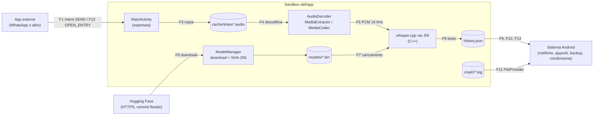

# Threat model di Sbobina

| | |
|---|---|
| **Versione analizzata** | 1.4.0 (build 6), commit `a9ba628`. Stati aggiornati dopo le mitigazioni del 2026-11-17, non ancora verificate su dispositivo |
| **Data** | 2026-11-17 |
| **Metodo** | Schema dei flussi di dati (DFD) con trust boundary, minacce enumerate con STRIDE, verifica sul codice, rischio = probabilità × impatto |
| **Tipo di analisi** | Statica (lettura del codice e della configurazione). Nessun test su dispositivo, nessun fuzzing |

Il documento risponde a quattro domande: *cosa stiamo costruendo* (§1–5), *cosa può andare storto* (§6), *cosa facciamo al riguardo* (§7–8), *abbiamo fatto un buon lavoro* (§9–10).

---

## 1. Perimetro

**Dentro l'analisi:** l'app Android (Kotlin, il bridge JNI in C++, come usiamo whisper.cpp), il download del modello, la build e la distribuzione dell'APK.

**Fuori dall'analisi:** la sicurezza di Android stesso; telefoni con root o già compromessi; WhatsApp; l'infrastruttura di Hugging Face e GitHub; i bug interni di whisper.cpp e ggml (trattati come dipendenza esterna: analizziamo come li usiamo, non il loro codice).

Non esiste un backend: l'app non ha server, account né analytics.

## 2. Asset

| # | Asset | Proprietà | Note |
|---|---|---|---|
| A1 | Audio condiviso | Riservatezza | Spesso è la voce di terzi e può contenere categorie particolari di dati (salute, lavoro…) |
| A2 | Testi trascritti e cronologia (`files/history.json`) | Riservatezza, integrità | A1 in forma leggibile, cercabile e persistente |
| A3 | Metadati: nome file, durata, date | Riservatezza | Rivelano chi ha comunicato con chi e quando |
| A4 | File del modello (`files/models/*.bin`, 190–574 MB) | Integrità | Lo legge codice C++: un file malevolo può corrompere la memoria |
| A5 | Crash log (`files/crash/*.log`) | Riservatezza | L'utente li invia a terzi |
| A6 | Chiave di firma e APK pubblicato | Integrità | Chi controlla la chiave controlla gli aggiornamenti |
| A7 | Risorse del telefono (spazio, RAM, batteria) | Disponibilità | Asset minore |

## 3. Requisiti di sicurezza

Sono le promesse fatte nel README, trattate come requisiti verificabili.

| # | Requisito | Stato | Minacce collegate |
|---|---|---|---|
| R1 | L'audio non viene mai salvato | **Rispettato con riserva**: copia temporanea in cache, cancellata dopo la decodifica e all'avvio successivo se il processo muore; README riformulato | T13 |
| R2 | Nulla esce dal telefono, a parte il download del modello | **Rispettato** (da confermare con un trasferimento reale, vedi T14) | T14 |
| R3 | La cronologia è esclusa dai backup | **Mitigato** con `dataExtractionRules` (da confermare su dispositivo) | T14 |
| R4 | La notifica non mostra il testo ed è privata sulla schermata di blocco | Testo: **rispettato**. Schermata di blocco: **parziale**, dipende dalle impostazioni dell'utente | T17 |
| R5 | I log non contengono nomi di file né testi | **Rispettato**, con un rischio residuo minimo | T18, T19 |

## 4. Attori di minaccia

| Attore | Capacità di partenza |
|---|---|
| Chi invia un audio | Chiunque su WhatsApp: costruisce il file che l'app decodificherà |
| Altra app sul telefono | Inviare intent all'activity esportata, leggere ciò che l'app espone ad altre app |
| Chi ha il telefono in mano | Schermata di blocco, schermata delle app recenti, telefono sbloccato |
| Attaccante di rete | Intercettare o alterare il traffico (es. Wi-Fi pubblico) |
| Supply chain | Hugging Face, GitHub Releases, repository Maven, Gradle, whisper.cpp copiato nel repository |

## 5. Modello del sistema

### Flussi di dati

| # | Flusso | Dati | Codice |
|---|---|---|---|
| F1 | App esterna → `MainActivity` | Intent `SEND` con URI scelto dal mittente | `MainActivity.handleShare` |
| F2 | `MainActivity` → `MediaMetadataRetriever` | Nome e durata (parser su file non fidato) | `MainActivity.durationMs` |
| F3 | URI → `cache/share*.audio` | Copia completa dell'audio | `AudioDecoder.decode` |
| F4 | Cache → `MediaExtractor` / `MediaCodec` | Decodifica in PCM 16 kHz mono | `AudioDecoder.decodeFile` |
| F5 | PCM → JNI → whisper.cpp | Trascrizione, callback per segmento | `WhisperBridge`, `whisper_jni.cpp` |
| F6 | Hugging Face → `.part` → `models/*.bin` | Download con ripresa, verifica SHA-256 | `HttpDownloader`, `ModelManager.ensure` |
| F7 | `models/*.bin` → `whisper_init_from_file` | Il parser nativo legge il modello | `nativeInit` |
| F8 | Testo → `history.json` | Scrittura atomica | `JsonHistoryStore` |
| F9 | Testo → appunti / intent di condivisione | Uscita per scelta dell'utente | `ResultActions` |
| F10 | Nome e durata → notifica | Visibile sulla schermata di blocco | `ResultNotifier` |
| F11 | Trace ed eccezioni → `.log` → `FileProvider` | Crash report inviato dall'utente | `CrashReporter`, `MainActivity.shareCrashReport` |
| F12 | Tap sulla notifica → `OPEN_ENTRY` | Id della voce di cronologia | `MainActivity.handleIntent` |
| F13 | `files/` → backup / trasferimento su un nuovo telefono | Tutti i file privati | `AndroidManifest.xml` |

### Trust boundary

| # | Confine | Flussi |
|---|---|---|
| TB1 | Intent in ingresso (activity `exported=true`) | F1, F12 |
| TB2 | Contenuto del file audio | F2, F3, F4 |
| TB3 | Rete | F6 |
| TB4 | Dal file del modello al codice C++ | F7 |
| TB5 | Dati in uscita (notifiche, appunti, condivisione, log, backup) | F9, F10, F11, F13 |
| TB6 | Supply chain (build, dipendenze, firma, distribuzione) | — |

## 6. Minacce e verifica

Stato: **Aperta** (nessuna difesa efficace), **Parziale** (difesa incompleta), **Mitigata**, **Accettata** (rischio residuo consapevole).

| ID | TB | STRIDE | Minaccia | Evidenza | Stato |
|---|---|---|---|---|---|
| T1 | TB1 | I, E | Confused deputy: URI `file://` o del nostro `FileProvider` aperti con i permessi di Sbobina | `handleShare` accetta solo `content://` e rifiuta l'authority `${applicationId}.logs` | Mitigata |
| T2 | TB1 | S, T | Un'app sostituisce il file in attesa o falsifica il nome mostrato | Da Android 10 le app in background non possono aprire activity; durante il lavoro i nuovi file sono ignorati | Mitigata |
| T3 | TB1 | I | `OPEN_ENTRY` inviato da un'altra app apre una voce della cronologia | Serve l'UUID casuale; apre solo sullo schermo dell'utente (`HistoryViewModel.kt:30`) | Mitigata |
| T4 | TB2 | E | File malevolo sfrutta un bug nei parser multimediali (classe Stagefright) | Nessuna difesa possibile nell'app. Con `minSdk 29` gli estrattori si aggiornano con gli aggiornamenti di sistema di Google Play e i codec software sono isolati | Accettata |
| T5 | TB2 | D | File enorme: copia in cache senza limite, memoria esaurita, ore di CPU | `copyTo` senza limite (`AudioDecoder.kt:28`). `OutOfMemoryError` gestito | Aperta |
| T6 | TB2 | D | Metadati assurdi (`channels=0`, `sampleRate=1`) | `Streaming` non valida i parametri (`AudioDecoder.kt:104`), ma le eccezioni sono intercettate dal ViewModel | Mitigata |
| T7 | TB2 | T | Audio costruito per far trascrivere un testo fuorviante | Limite del modello; il testo è mostrato come `Text` semplice (niente HTML, link, WebView) | Accettata |
| T8 | TB3 | T | Man-in-the-middle sostituisce il modello | HTTPS, URL fissato a un commit, SHA-256 nel codice verificato prima del rename (`ModelManager.kt:26`, `:110`) | Mitigata |
| T9 | TB3 | D | Download infinito riempie il disco | Il ciclo scrive senza limite (`HttpDownloader.kt:37`); controllo della dimensione solo alla fine | Aperta |
| T10 | TB3 | I | La rete e Hugging Face vedono che il telefono usa Sbobina | Inerente al download; dichiarato nel README | Accettata |
| T11 | TB4 | T, E | Modello modificato su disco dopo la verifica | Memoria interna scrivibile solo dall'app; controllo una sola volta accettabile senza root | Mitigata |
| T12 | TB4 | D, E | Use-after-free o crash nel codice JNI | Handle protetto da lock, `transcribe` sincronizzato, riferimento globale liberato. Manca il controllo `null` su `GetStringUTFChars` (`whisper_jni.cpp:74`) | Mitigata |
| T13 | TB5 | I | Audio temporaneo resta in cache se il processo muore durante la decodifica | `createTempFile` in `cacheDir` (`AudioDecoder.kt:21`), `AudioDecoder.deleteStaleTempFiles` in `SbobinaApp.onCreate`, con test | Mitigata |
| T14 | TB5 | I | La cronologia finisce nel trasferimento su un nuovo telefono | `res/xml/data_extraction_rules.xml` esclude tutti i domini da `cloud-backup` e `device-transfer`; collegato in `AndroidManifest.xml` | Mitigata (da verificare su dispositivo) |
| T15 | TB5 | I | Testo copiato visibile nell'anteprima degli appunti | `setText` senza segnalazione di contenuto sensibile (`ResultActions.kt:27`); da Android 10 le app in background non leggono gli appunti | Parziale |
| T16 | TB5 | I | Trascrizione visibile nella schermata delle app recenti | Nessun `FLAG_SECURE` né anteprima disattivata | Parziale |
| T17 | TB5 | I | Nome del file sulla schermata di blocco | `setPublicVersion` senza nome del file (`ResultNotifier.kt`) | Mitigata |
| T18 | TB5 | I | Dati personali nei crash log | Il trace contiene modello, durata, RAM; lo stack trace delle eccezioni non gestite è scritto per intero | Mitigata |
| T19 | TB5 | I | Testo trascritto in logcat | Nessun `Log` nell'app; whisper.cpp scrive su `stderr` (non arriva a logcat); `print_realtime=false` | Mitigata |
| T20 | TB5 | R | Nessuna traccia di chi ha trascritto o cancellato cosa | App con un solo utente | Accettata |
| T21 | TB6 | T | whisper.cpp copiato senza modo di verificarne la provenienza | Tag `v1.9.5` e commit registrati in `docs/WHISPER_CPP.md`; `scripts/verify-whisper.ps1` confronta ogni file con l'archivio ufficiale (1497 file identici) | Mitigata |
| T22 | TB6 | T, S | Build e distribuzione senza verifiche di integrità | `distributionSha256Sum` e `gradle/verification-metadata.xml` presenti; fingerprint del certificato nel README. Restano: nessuna CI, chiave di firma da custodire offline (organizzativo) | Parziale |

## 7. Rischio e piano di mitigazione

| Priorità | ID | P | I | Rischio | Mitigazione |
|---|---|---|---|---|---|
| 1 | T14 | Media | Medio | Medio | `res/xml/data_extraction_rules.xml` che esclude tutti i domini sia da `cloud-backup` sia da `device-transfer`, collegato con `android:dataExtractionRules` |
| 2 | T22 | Bassa | Alto | Medio | `distributionSha256Sum` nel wrapper; `gradle/verification-metadata.xml`; fingerprint SHA-256 del certificato di firma nel README; chiave di firma custodita offline; in futuro build delle release in CI |
| 3 | T13 | Bassa–Media | Medio | Medio | Cancellare `cache/share*.audio` in `SbobinaApp.onCreate`; riformulare R1 nel README |
| 4 | T17 | Alta | Basso | Basso–Medio | `setPublicVersion` con una notifica senza nome del file |
| 5 | T21 | Bassa | Alto | Basso–Medio | Registrare tag e commit upstream di whisper.cpp e uno script che confronta la copia con l'archivio ufficiale |
| 6 | T1 | Bassa | Basso | Basso | In `handleShare` accettare solo `content://` e rifiutare l'authority `${applicationId}.logs` |
| 7 | T9 | Bassa | Basso | Basso | Interrompere il download quando supera `expectedBytes` |
| 8 | T5 | Bassa | Basso | Basso | Limite di dimensione sulla copia in cache |
| 9 | T15 | Media | Basso | Basso | `ClipDescription.EXTRA_IS_SENSITIVE` su API 33+ |
| 10 | T16 | Media | Basso | Basso | `setRecentsScreenshotEnabled(false)` su API 33+, se il prodotto lo vuole |

Pulizia senza impatto sulla sicurezza: controllo `null` su `GetStringUTFChars` in `nativeInit`; validazione di `sampleRate` e `channels` prima di creare `PcmConverter.Streaming`.

## 8. Rischi accettati

| ID | Motivo |
|---|---|
| T4 | I parser multimediali sono di Android: l'app può solo restare su versioni che ricevono aggiornamenti (`minSdk ≥ 29`) |
| T7 | La trascrizione può essere errata o manipolata: limite del modello, non dell'app |
| T10 | Il download del modello è necessario e dichiarato |
| T20 | La repudiation non si applica a un'app locale con un solo utente |
| T16 | (Se non si adotta la mitigazione) poter fare screenshot del testo è una funzione utile |

## 9. Limiti dell'analisi

- **Solo analisi statica.** Il comportamento di T14 (trasferimento tra dispositivi) è dedotto dalla documentazione di Android e va confermato con un trasferimento reale o con `bmgr`. Nessuna minaccia è stata riprodotta su dispositivo.
- **whisper.cpp e ggml non sono stati analizzati internamente.** Il parser del modello (TB4) è protetto solo dalla verifica SHA-256. Un aggiornamento di whisper.cpp riapre questa valutazione.
- **Nessun fuzzing.** `AudioDecoder` e `PcmConverter` sono buoni candidati per test con file malformati.
- **Telefono con root o malware con privilegi di sistema**: fuori perimetro. Con quei privilegi tutti gli asset sono leggibili.

## 10. Quando aggiornare questo documento

Rivedere le sezioni interessate quando una modifica:
- aggiunge un permesso, un componente esportato o un nuovo `intent-filter` (TB1);
- legge un nuovo formato o una nuova fonte di input (TB2);
- aggiunge una connessione di rete o cambia l'URL o il modello scaricato (TB3, TB4);
- aggiorna whisper.cpp (TB4, TB6);
- salva nuovi dati su disco, cambia notifiche, log, condivisione o backup (TB5);
- cambia il processo di build, firma o pubblicazione (TB6).

Aggiornare anche la tabella dei requisiti (§3) quando cambiano le promesse del README.
